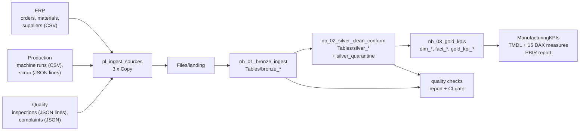

# fabric-lakehouse-lab

[](https://github.com/hamza2829/fabric-lakehouse-lab/actions/workflows/ci.yml)

A Microsoft Fabric style lakehouse for a manufacturer, built entirely from files in git:
synthetic ERP, production and quality data with realistic defects, Fabric notebooks
(PySpark and Spark SQL) that move it through bronze, silver and gold Delta tables, Fabric data
pipelines that orchestrate them, data quality checks with a CI gate, and a Power BI project
(TMDL semantic model with 15 DAX measures and a PBIR report) over the gold tables.

Everything runs locally and in GitHub Actions with `pip install` only: no Microsoft tenant,
no API keys, no accounts, no Docker, no manual steps.

## What is in the repo

| Folder | Content |
|---|---|
| [`data/`](data/) | `generate_data.py`: seeded generator for three source systems, CSV and JSON, with deliberate errors and a manifest of every injected defect |
| [`notebooks/`](notebooks/) | three Fabric notebooks in Fabric's git format (`notebook-content.py` with `# CELL`, `# MAGIC %%sql`, `# PARAMETERS CELL` markers): bronze ingest, silver clean and conform, gold KPIs |
| [`pipelines/`](pipelines/) | Fabric Data Pipeline definitions (`pipeline-content.json`: copy, notebook and invoke pipeline activities), a daily schedule, `validate.py` and `run.py` |
| [`lakehouse/`](lakehouse/) | the Lakehouse item `lh_manufacturing` |
| [`quality/`](quality/) | data quality rules (`rules.toml`) for keys, duplicates, ranges, referential integrity, units, late records and freshness, and the report writer with the CI gate |
| [`powerbi/`](powerbi/) | Power BI project: `ManufacturingKPIs.SemanticModel` (TMDL, Direct Lake) and `ManufacturingKPIs.Report` (PBIR) |
| [`fabric_local/`](fabric_local/) | the local runtime: notebook parser and executor, pipeline validator and runner, expression evaluator, TMDL reader, a small DAX evaluator |
| [`docs/`](docs/) | [architecture and data flow](docs/architecture.md), [data dictionary](docs/data_dictionary.md), [KPI definitions](docs/kpi_definitions.md), [Fabric mapping](docs/fabric_mapping.md), [branching and releases](docs/git_branching.md), [release notes](docs/release_notes.md) |
| [`tests/`](tests/) | 84 pytest tests |

## Architecture



`pl_lakehouse_daily` runs the chain: it invokes `pl_ingest_sources`, then the three notebooks
in order, passing `load_date`, `as_of` and the run id as notebook parameters. Details, the
silver rule order and the local runtime are in [docs/architecture.md](docs/architecture.md).

**Bronze** keeps every value as text plus lineage columns, so nothing a source sends is lost.
**Silver** types the data, converts units (`PCS`/`pc`/`Stk`/`DZ` to pieces, hours to minutes,
scrap in KG to pieces via the material weight), sends rows with missing keys, orphan
references, impossible values or future dates to `silver_quarantine` with a reason, removes
duplicates (newest extract wins) and flags late records instead of dropping them.
**Gold** is a star schema (4 dimensions, 4 facts) plus KPI tables whose names match the DAX
measures one to one.

## Run it

Prerequisites: Python 3.11 and Java 17 on the path. Spark runs on Linux and macOS as is; on
Windows it needs Hadoop's `winutils.exe` (see [Honest notes](#honest-notes)).

```bash
python -m venv .venv && . .venv/bin/activate
pip install -r requirements.txt

python pipelines/validate.py                    # pipelines, schedule, notebooks
python data/generate_data.py --seed 42          # data/raw/ + _manifest.json
python pipelines/run.py pl_lakehouse_daily      # copy -> bronze -> silver -> gold
python -m quality.run_quality                   # reports/quality_report.md, exit 1 over threshold
python -m pytest                                # 84 tests
```

The lakehouse appears under `onelake/ws_manufacturing/lh_manufacturing.Lakehouse/` with the
same `Files/` and `Tables/` split as OneLake. The first Spark start downloads the Delta Lake jars
from Maven Central.

CI ([`.github/workflows/ci.yml`](.github/workflows/ci.yml)) runs exactly these steps on every
push, writes the quality report into the job summary and uploads it as the `quality-report`
artifact.

## Results

From the CI build with seed 42 (period 1 Apr to 30 Sep 2026, as-of 30 Sep 2026 23:59:59).
The block is generated by `python tools/render_results.py --write`, and a test fails if it no
longer matches the build.

<!-- results:start -->
### Rows per layer

| Source | Entity | Bronze | Quarantined | Duplicates removed | Silver |
|---|---|---:|---:|---:|---:|
| erp | suppliers | 43 | 0 | 3 | 40 |
| erp | materials | 129 | 6 | 3 | 120 |
| erp | orders | 5,844 | 78 | 90 | 5,676 |
| production | machines | 12 | 0 | 0 | 12 |
| production | machine_runs | 3,697 | 35 | 40 | 3,622 |
| production | scrap_events | 4,393 | 45 | 50 | 4,298 |
| quality | inspections | 2,919 | 30 | 30 | 2,859 |
| quality | complaints | 107 | 9 | 6 | 92 |
| **all** | | **17,144** | **203** | **222** | **16,719** |

### Issues found in bronze and fixed in silver

| Issue | ERP | Production | Quality | Total | Handling | Left in silver |
|---|---:|---:|---:|---:|---|---:|
| missing_key | 37 | 27 | 12 | **76** | quarantined (`missing_key`) | 0 |
| duplicate | 96 | 90 | 36 | **222** | removed, newest extract wins | 0 |
| orphan_fk | 24 | 28 | 15 | **67** | quarantined (`orphan_fk`) | 0 |
| out_of_range | 15 | 20 | 12 | **47** | quarantined (`out_of_range`) | 0 |
| future_date | 8 | 5 | 0 | **13** | quarantined (`future_date`) | 0 |
| unit_mismatch | 170 | 110 | 0 | **280** | converted (pieces, minutes) | 0 |
| late_arrival | 50 | 75 | 25 | **150** | kept, flagged `is_late_arrival` | n/a (flagged) |
| stale_source (tables) | 0 | 0 | 1 | **1** | reported as warning (complaints: newest received_at 2026-09-24 12:00, age 156.0 h (SLA 72 h)) | not fixable in the lakehouse |

Quality gate: **PASS**. Bronze issue rate per source: erp 6.65%, production 4.38%, quality 3.30% (limit 10%); error findings left in silver: 0.

### Gold tables

| Table | Rows |
|---|---:|
| `dim_date` | 214 |
| `dim_material` | 120 |
| `dim_supplier` | 40 |
| `dim_machine` | 12 |
| `fact_orders` | 5,676 |
| `fact_production` | 3,622 |
| `fact_inspections` | 2,859 |
| `fact_complaints` | 92 |
| `gold_kpi_summary` | 15 |
| `gold_kpi_monthly` | 6 |

### KPIs (grand total, Apr to Sep 2026)

Computed by Spark SQL in `gold_kpi_summary` and recomputed from the DAX measures in the TMDL files by the tests.

| Area | KPI (DAX measure) | Value |
|---|---|---:|
| Delivery | Order Lines | 5,676 |
| Delivery | Net Sales EUR | 34,161,435.96 |
| Delivery | Delivered Lines | 5,270 |
| Delivery | On-Time Lines | 4,551 |
| Delivery | On-Time Delivery % | 86.4 % |
| Production | Units Produced | 1,743,878 |
| Production | Scrap Units | 32,712 |
| Production | Scrap Rate % | 1.88 % |
| OEE | Availability % | 88.9 % |
| OEE | Performance % | 86.9 % |
| OEE | Quality Rate % | 98.1 % |
| OEE | OEE % | 75.8 % |
| Quality | Complaints | 92 |
| Quality | Complaint Rate % | 1.75 % |
| Quality | Inspection Pass Rate % | 90.3 % |
<!-- results:end -->

## Data quality

[`quality/rules.toml`](quality/rules.toml) defines the checks per entity: not null keys,
unique keys, value ranges, column comparisons (downtime within planned time, defects within
sample size), allowed units, referential integrity, no future dates, late arrival and
freshness. Each rule runs on the bronze table (to show what a source delivered) and on the
silver table (to prove it was fixed). The report lists inconsistencies per source and entity,
what silver did with them, the quarantine by reason and freshness per table.

The gate fails CI when a source system's bronze issue rate exceeds 10 % or when any error level
finding is left in silver. The stale complaints feed is reported as a warning
(`fail_on_freshness = false`). Because the generator records every defect it injects, the tests
also require the checks to find **exactly** the injected counts, no more and no fewer.

## Power BI project

* `ManufacturingKPIs.SemanticModel/definition/`: `model.tmdl`, `database.tmdl`,
  `expressions.tmdl` (Direct Lake source), `relationships.tmdl` (11 many to one relationships)
  and one `.tmdl` per table with Direct Lake entity partitions.
* 15 measures: Order Lines, Net Sales EUR, Delivered Lines, On-Time Lines, On-Time Delivery %,
  Units Produced, Scrap Units, Scrap Rate %, Availability %, Performance %, Quality Rate %,
  OEE %, Complaints, Complaint Rate %, Inspection Pass Rate %. Definitions in
  [docs/kpi_definitions.md](docs/kpi_definitions.md).
* `ManufacturingKPIs.Report/definition/`: three pages (Overview, Production and OEE, Quality)
  with cards, line, bar and table visuals bound to the measures.

`tests/test_powerbi.py` parses the TMDL and checks measure and column references,
relationships, partitions and report bindings. `tests/test_lakehouse.py` compares every TMDL
column with the real gold Delta schema, checks every relationship against the gold data
(unique one side, no orphans), and evaluates all 15 DAX measures with a small DAX evaluator
against the gold tables, requiring the same values that Spark SQL wrote to `gold_kpi_summary`.

## Tests

84 tests in `tests/`:

| File | What it covers |
|---|---|
| `test_generator.py` | determinism by seed, formats, manifest arithmetic, every defect type present |
| `test_notebooks.py` | Fabric notebook format, parameters cell, Spark SQL cells, lakehouse binding, executor with parameter injection and `notebookutils.notebook.exit` |
| `test_pipelines.py` | validator (cycles, unknown dependencies and notebooks, undeclared parameters, bad expressions), schedule, expressions, copy run, retries and skipped downstream activities |
| `test_quality_checks.py` | every check type, the gate, the rules file, bronze rules against the injected defects |
| `test_powerbi.py` | 15 measures, references, star schema, Direct Lake partitions, report bindings, TMDL parser, DAX evaluator |
| `test_lakehouse.py` | end to end on the built lakehouse: row accounting per layer, quarantine reasons equal injected defects, unit conversions, TMDL vs gold schema, relationships in data, DAX vs Spark SQL KPIs, quality gate, README results |
| `test_docs.py` | data dictionary and KPI docs cover the model, diagram names every item |

Locally, the `lakehouse` tests skip until the pipeline has run; CI sets `REQUIRE_LAKEHOUSE=1`
so they must pass there.

## Honest notes

* **The data is synthetic.** It comes from a seeded generator, not from a real plant. The
  defect rates and KPI levels are chosen to look plausible, and the defects are injected on
  purpose so the checks can be verified against known counts.
* **Spark and Delta Lake run locally**, from `pyspark` and `delta-spark` installed with pip, in
  `local[2]` mode. This is the same open source engine and table format Fabric uses, not
  Fabric's runtime, and it was run on Linux in CI. On Windows, Spark writes need Hadoop's
  `winutils.exe`, which this repo does not ship.
* **The Fabric items are Fabric-format files** (git integration layout, notebook source format,
  pipeline JSON, TMDL, PBIR), written by hand and checked by the validator and tests in this
  repo. There is **no live Fabric tenant**: nothing here was deployed to a workspace, synced
  through Fabric git integration, or opened in Power BI Desktop, so Fabric itself may reject
  details that these checks cannot see.
* **`fabric_local/` is an emulation**, not Fabric: notebooks run in one local Spark session,
  pipelines run sequentially, only the expression functions the pipelines use are implemented,
  and timeouts are not enforced. The DAX evaluator covers only the functions the 15 measures
  use and evaluates grand totals, not filter contexts from visuals.
* The OEE is "OEE-style": planned time is the booked shift time and quality counts scrap only.

How each part maps onto a real tenant is described in [docs/fabric_mapping.md](docs/fabric_mapping.md).

## License

MIT, see [LICENSE](LICENSE).
