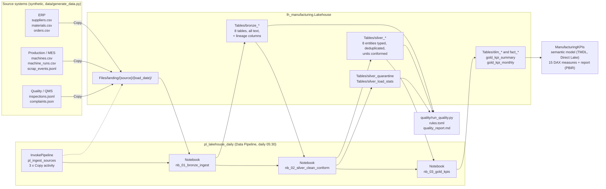
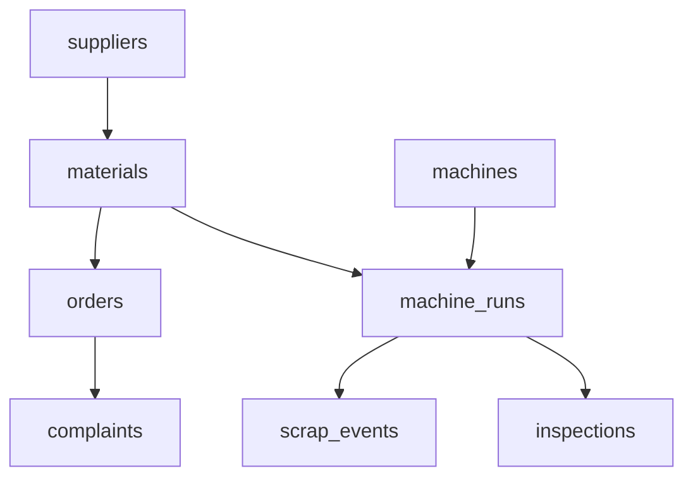

# Architecture and data flow

The lab follows the medallion pattern inside one Fabric lakehouse, `lh_manufacturing`.
Raw files land in the **Files** area, every layer after that is a Delta table in **Tables**.

## Layers

| Layer | Where | What happens | Tables |
|---|---|---|---|
| Landing | `Files/landing/<source>/<load_date>/` | binary copy of the nightly extracts, nothing parsed | files only |
| Bronze | `Tables/bronze_*` | one Delta table per file, **every value kept as text**, plus `_source_file`, `_ingested_at`, `_batch_id`, `_load_date` | 8 |
| Silver | `Tables/silver_*` | typing, unit conversion, validation, quarantine, deduplication, late arrival flags | 8 entities + `silver_quarantine` + `silver_load_stats` |
| Gold | `Tables/dim_*`, `fact_*`, `gold_*` | star schema for the semantic model, KPI tables | 4 dims, 4 facts, 2 KPI tables |

## Silver processing order

Entities are processed so that every foreign key is checked against an already cleaned parent:

For each entity the notebook applies ordered rules. The first failing rule names the
quarantine reason, so every rejected row has exactly one reason:

1. `missing_key`: a business or foreign key is NULL or empty
2. `orphan_fk`: a foreign key has no match in the cleaned parent
3. `unknown_unit`: a unit that has no conversion factor
4. `out_of_range`: negative quantities, downtime above planned time, defects above sample size
5. `future_date`: an event after the as-of time of the load
6. `invalid_value`: e.g. delivery before order, an unknown inspection result

Rows that pass are deduplicated on the business key (newest extract wins), units are converted
(`PCS`, `pc`, `Stk` to `PC`, `DZ` x 12, hours to minutes, scrap `KG` to pieces via the material
net weight) and late records are **kept** with `is_late_arrival = true`.

## Local runtime

`fabric_local/` stands in for the parts of Fabric that are not files:

| Fabric | Local stand-in |
|---|---|
| Spark runtime with Delta | `pyspark` + `delta-spark` from pip, `local[2]` |
| default lakehouse, relative `Files/` and `Tables/` paths | JVM working directory set to `onelake/ws_manufacturing/lh_manufacturing.Lakehouse` |
| lakehouse table discovery | every Delta folder under `Tables/` is registered in the session catalog after each cell |
| `notebookutils.notebook.exit` | raises an exit carrying the value, which the pipeline activity output exposes |
| pipeline orchestration | `fabric_local/pipeline.py`, topological order, retries, dependency conditions |
| connection to the plant file share | `pipelines/connections.local.json` maps the connection id to `data/raw` |
