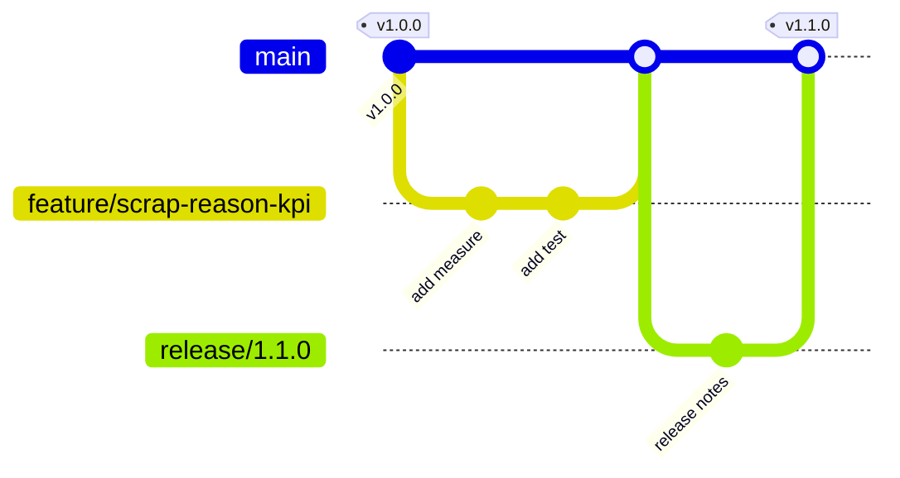

# Git branching and releases

The repository is the single source for every Fabric item, so the branching model is also the
deployment model.

## Branches

| Branch | Purpose | Fabric workspace (when connected) |
|---|---|---|
| `main` | released state, protected, only merged through pull requests with green CI | `ws_manufacturing` (production) |
| `feature/<short-name>` | one change: a notebook, a rule, a measure | a personal or feature workspace branched out from `main` |
| `release/<version>` | optional stabilisation branch for a larger release | `ws_manufacturing_test` |
| `hotfix/<short-name>` | urgent fix cut from the latest tag | merged back to `main` |

## Rules

1. Branch from `main`, keep branches short lived, rebase on `main` before review.
2. Every pull request runs `ci.yml`: pipeline validation, data generation, the full pipeline,
   the quality gate and all tests. Red CI blocks the merge.
3. A change to a gold column or KPI updates in the same pull request:
   the gold notebook, the TMDL table or measure, `docs/data_dictionary.md` or
   `docs/kpi_definitions.md`, and the README results (`python tools/render_results.py --write`).
   The tests catch each of these if forgotten.
4. Commit messages say what changed and why (`silver: quarantine runs with downtime above plan`).
5. Releases are tagged `vMAJOR.MINOR.PATCH` on `main` and described in `docs/release_notes.md`:
   * MAJOR: a breaking change for consumers (renamed gold column, removed measure)
   * MINOR: new tables, columns, measures or rules
   * PATCH: fixes that do not change the gold contract
6. Never edit Fabric items in the production workspace directly. Changes made in a feature
   workspace are committed from Fabric's source control panel to the feature branch.

## Release steps

1. Update `docs/release_notes.md` and the version in `pyproject.toml`.
2. Merge to `main` with green CI.
3. Tag: `git tag -a v1.1.0 -m "v1.1.0"` and push the tag.
4. In Fabric (not automated in this lab): update the production workspace from git, apply
   `schedule.json` through the job scheduler API, refresh or reframe the Direct Lake model.
